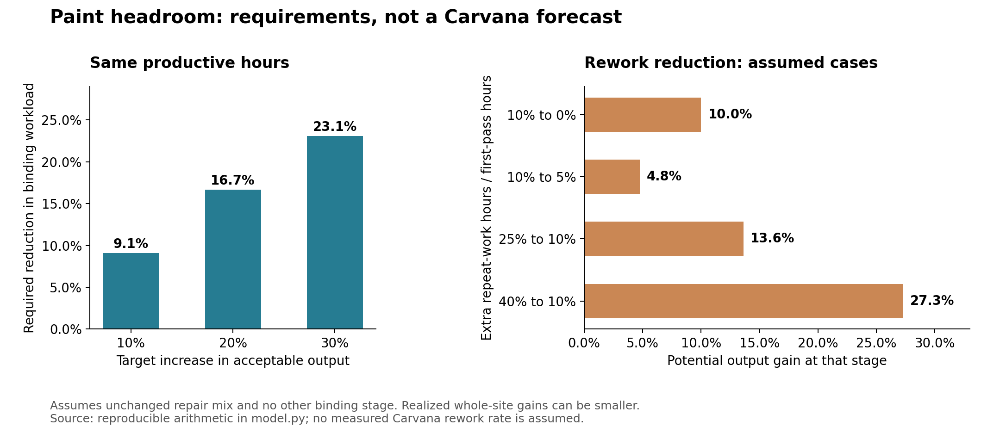
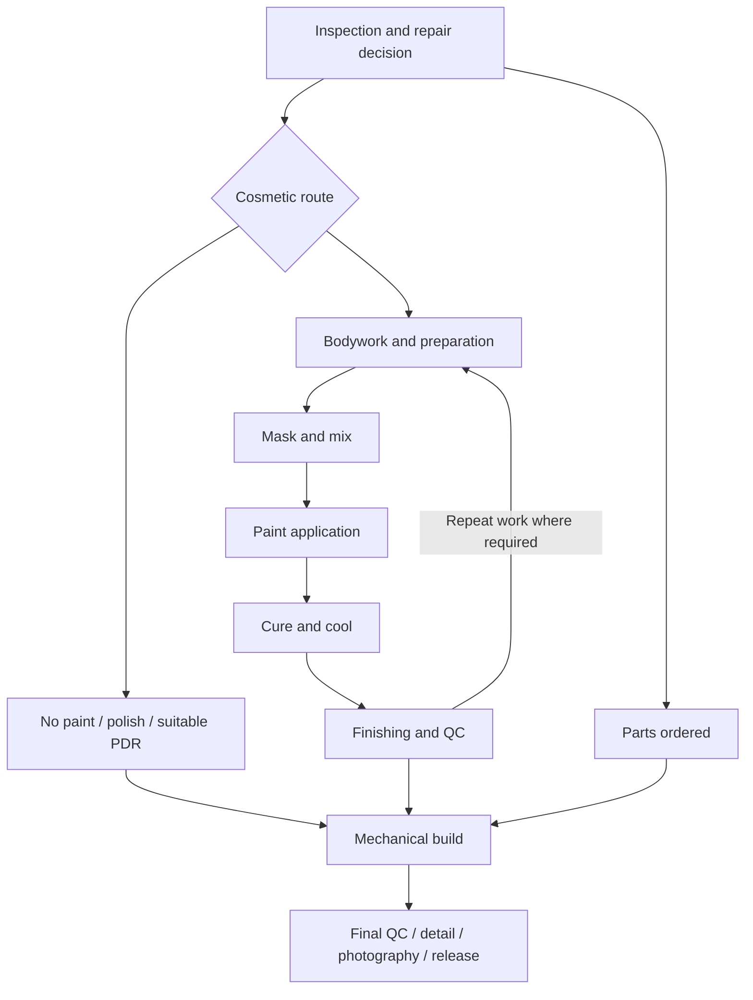

# Carvana paint bottleneck: evidence and executable-headroom model

**As of October 31, 2026.** This completes the public-evidence/modeling pass; it does not estimate a national utilization rate. [Requirements and scenarios](requirements.md) · [Inputs](inputs.json) · [Results](results.json) · [Evidence register](evidence.json) · [Reproduce](model.py)

## Direct conclusion

**The strongest supported mechanism is a paint/cosmetics flow constraint that combines equipment occupancy with skilled-labor allocation and repair workload. Public evidence does not identify how much current Carvana output is recoverable through optimization.** We can nevertheless establish demanding, falsifiable requirements for 10–30% more output and test whether proposed improvements would actually reach sale-ready release.

The new findings refine the model:

1. Tolleson's historical supplier description specifies four-booth, side-loading lines traversed by vehicles. A booth count cannot automatically be treated as a count of interchangeable parallel production servers. Current station functions, line completion and hours remain unknown. [S1](sources.md#s1)
2. Visual inspection resolves the directions on a previously unreadable 2024 Carvana/Accenture slide: cycle time down 60%, first-time QC pass up 13%. The slide lacks a clear baseline, population, timing window and percent-versus-percentage-point definition for QC. These are historical company/vendor claims, not estimates of remaining paint headroom. [S2](sources.md#s2)
3. Technical sources distinguish booth cycles, refinish work content, curing time and elapsed repair time. They are not interchangeable units. Parts batching and off-booth preparation can improve flow, but Carvana already uses side-loading equipment at documented sites, so their entire advertised benefit is not new upside. [S3–S6](sources.md#s3)
4. Rework reduction, better allocation, faster curing and easier vehicle mix produce different mathematical effects. They must be modeled separately; another stage can absorb all apparent paint gains.

**No new numerical sales or production forecast is justified.** The useful result is a conditional requirements model, historical equipment anchors and explicit evidence gaps. The illustrative plant is not calibrated to Carvana or presented as a plausible confidence interval.

**Follow-up:** the [matched-observation search](matched-observation-search-2026-10-31.md) found historical staffing-sensitive inspection cadence and a cosmetic-labor estimate, but no site-period combination sufficient to estimate current paint headroom. These partial measurements do not change model inputs.

## Evidence quality and site register

| Site | Dated equipment/process anchor | Demonstrated or reported output | Current missing variables |
|---|---|---|---|
| Tolleson | Historical supplier: eight booths installed in phase one; twelve contemplated, grouped into four-booth lines. March 2026 CEO testimony specifically identifies paint as a recurring constraint. | Supplier's 30 painted vehicles/day/line is a historical design claim; shift length not given. | Current installed/operational line configuration, staffed hours, workloads, actual throughput. |
| Elyria | June 2026 tours describe four physical lines, two shifts, side-loading paint movement; physical retail lines are not established as paint lines. | Citizens reports ~1,280 whole-site vehicles/week; JPM calls ~1,300 capacity at the same event. | Paint-stage equipment schedule, incidence, hours, rework and matching staffing. |
| Greenfield | Contractor documents eight paint booths in 2019. | No matched site output. Existing OSHA labor data have 2025 scope changes. | Current booths, routing, stage-specific paid/productive hours and output. |
| Trenton | Municipal 2022 opening account: twelve paint booths, 91 lifts, three photo domes. | No matched output; later FTE/annual-employee observations differ. | Same missing operating/workload fields; staffing commitments are not capacity. |
| Haines City | Existing tours describe line/shift expansion; full paint configuration unresolved. | No accepted matched output observation; one implausible printed figure previously excluded. | Paint-stage resources and workload; 40% parking occupancy is unusable as factory utilization. |

Existing findings and provenance: [equipment follow-up](../equipment-followup-2026-10-31.md), [ramp evidence](../ramp-evidence-2026-10-30.md), [sellside synthesis](../../../sellside/2026-10-31-expanded-synthesis.txt). The structured register retains unknowns as null rather than filling them from other sites.

**Elyria permit attempt:** Ohio's official instructions now route issued-air-permit retrieval through its eDocument portal. Reopened the public portal, confirmed the three previously identified June/August documents, tried its selected-document ZIP control and document link. Neither produced an accessible document or new tab. Prior direct retrieval returned challenge HTML. No CAPTCHA bypass, outreach or guessed endpoint crawl attempted. Permit metadata does not establish machinery changes. [S7](sources.md#s7)

## Process map and units

June Elyria tours describe cosmetics ahead of mechanical repairs, allowing parts to arrive meanwhile. Alternate cosmetic methods can bypass full painting. PDR is skilled work, not a free bypass, and may not suit damage with broken paint. The detailed sequence, booth location of masking/curing, shared labor and rework path must be confirmed for each site. The diagram is a research map, not a certified universal routing. [S8](sources.md#s8)

For each resource r and repair category c:

`workload_r per accepted release = sum(category_share_c × first-pass resource-hours_r,c) + expected repeat/other consumed resource-hours_r`

`resource-supported releases = usable resource-hours_r / workload_r`

`system output <= minimum supported releases across all necessary resources`

A paint labor-hour is not a booth-hour. A booth may remain occupied during curing without a painter; a painter may also work outside the booth. A serial line requires a separate constraint for each station and cannot pool every booth-hour indiscriminately. With parts batching, count compatible work content per cycle, not one car per cycle by default. Inventory writes to wholesale or other removals after consuming recon work must be included in the accepted-release denominator when measured.

Aggregate resource inequalities are necessary but not sufficient: variability, changeovers, synchronized resources and blocking can reduce achieved flow below the calculated bounds. No stochastic model is fitted because the event-level data are missing.

The model separates five example categories: no paint, small repair, single panel, multiple panels and extensive repair. Every numerical category-hour assumption in the constructed example is marked **assumed**, including its bypass simplification. A measured deployment should add separate PDR/airbrush and line-station resources rather than absorb them into zero-work categories.

## What 10%, 20% and 30% growth require

At fixed productive resource-hours, the binding workload must fall by `1 − 1/(1+growth)`:

| More accepted output | Less binding workload per accepted vehicle | Elyria reference 1,280/week becomes* |
|---|---:|---:|
| 10% | 9.1% | 1,408 |
| 20% | 16.7% | 1,536 |
| 30% | 23.1% | 1,664 |

*Arithmetic reference only. This does not establish that paint alone limits Elyria or that these targets are feasible.

If the sole lever is available productive time, hours must rise by the target output percentage. Assuming an achievable availability ceiling of **85%**, 20% growth requires starting availability no higher than **70.8%**; 30% requires no higher than **65.4%**. The 85% ceiling is an explicit hypothesis, not a benchmark or sustainable Carvana target. Both labor and machinery must support the resulting schedule.

### Rework: how much can quality actually unlock?

Let e equal repeat-work resource-hours divided by first-pass resource-hours. Capacity gain from reducing e0 to e1 is `(1+e0)/(1+e1) − 1`, before bottleneck migration.

- 10% extra work reduced to 5% produces **4.8%** stage headroom.
- 25% reduced to 10% produces **13.6%**.
- 40% reduced to 10% produces **27.3%**.

To produce 20% more solely by eliminating rework, rework must initially be at least **16.7% of total consumed stage-hours**, equivalent to 20% extra hours relative to first-pass work. Eliminating only part of rework requires a larger starting burden. A first-pass QC improvement does not identify these hours: defects differ in repair duration, stage and detection timing. The 2024 QC statistic therefore cannot calibrate this lever.

### Faster curing: apply the improvement only to the affected time

If curing occupies share c of the constrained equipment's total cycle, reducing that duration 75% increases its theoretical output by `1/(1−0.75c)−1`. At c=10%, 25%, 50%, the gains are **8.1%, 23.1%, 60.0%**, before other constraints. These are assumed duration sensitivities, not product comparisons or Carvana forecasts.

PPG's product documentation distinguishes time at target metal temperature from heat-up, cooling and flash-off. Its 2026 EMEA launch offers rapid drying options, but Carvana adoption, compatible coatings and cost are unknown. Faster drying cannot automatically be applied to the entire booth cycle. [S5–S6](sources.md#s5)

### Easier mix versus better execution

At equal work per painted vehicle, paint incidence dropping from 50% to 41.7% supports 20% more total vehicles through a paint-limited system. This is a restrictive illustration. Diverting easy repairs to PDR may remove less-than-average booth workload; older vehicles may raise both incidence and work per affected vehicle. Track categories, not only the number painted.

## Ranked explanations and falsification tests

| Rank | Mechanism | Best evidence | Contrary evidence / decisive test |
|---|---|---|---|
| 1 | Allocation of skilled labor and management of flow | Tolleson-specific CEO explanation; tour accounts of targeted overtime and labor allocation | Test whether prepared cars and usable booths wait for qualified labor. If continuously occupied, allocation may not be the main remaining lever. |
| 2 | Repair scope, routing and alternative methods | Tours describe avoiding full paint where appropriate; newer-car mix in existing calls | Require age/damage category hours and PDR labor. Similar-mix improvement would distinguish execution from selection. |
| 3 | Equipment occupancy and serial-line balance | Supplier and contractor equipment descriptions | Need stage occupancy and idle-reason records. Current counts/design rates do not reveal saturation. |
| 4 | Rework and preparation quality | CEO mechanism; historical QC improvement; technical sources | Need repeat-work hours by cause. High first-pass performance would cap remaining upside. |
| 5 | Curing technology / batch loading | Supplier methods and product specifications | Need current technology and cycle breakdown. Existing advanced equipment could leave little remaining advantage. |
| Cross-cutting | Downstream build/release or sales absorption | Resource arithmetic and existing operations sequencing | Paint queues falling with unchanged accepted releases would show the constraint moved. |

These rankings reflect evidentiary support, not measured contributions to growth. Sites and shifts can have different constraints.

## Scenarios and cost implications

The executable example deliberately constructs a **400-vehicle/week** reference; it is not a Carvana site. Each category workload and resource budget is assumed. No parameter is fitted to Elyria's 1,280 figure.

| Scenario | Supported weekly output | Change | Limiting stage |
|---|---:|---:|---|
| Better booth availability plus reduced rework | 460 | +15% | Other release |
| 25% more hours across paint-related stages | 460 | +15% | Other release |
| Paint incidence 50%→60% through more multiple-panel repairs | 303 | −24% | Booth occupancy |
| 25% more booth capacity alone | 440 | +10% | Paint labor |
| Coordinated 30% expansion across every modeled resource | 520 | +30% | Booth occupancy |

The first scenario's isolated paint gains are larger than 15%; the downstream ceiling caps the result. The shift scenario purchases capacity that cannot all be used. The equipment-only scenario moves the constraint to painters. These are demonstrations of why a national optimization percentage cannot be inferred from booth counts.

With assumed loaded pay of $35/hour for prep/finishing and $45 for paint, and 80% productive hours per extra paid hour, the example shift extension adds roughly **$6,651 weekly labor cost for 60 extra supported units**, or **$111 per extra unit**, before materials, overtime premiums, training, energy and other costs. A reallocation case with no extra paid hours still has unmeasured implementation costs. BLS's May 2025 national body-repair median of $26.39/hour is contextual base pay for a broader occupation, not a Carvana painter or loaded-cost estimate. [S9](sources.md#s9)

No credible site-specific booth installation quotes, paint material costs or ramp schedules were found. Do not manufacture project costs or a commissioning timetable. Instead, the model includes:

- A labor-cost grid: 0.5–2 extra paid hours per added unit × $30–60 assumed loaded pay = **$15–120 per added unit**.
- A capital affordability screen based on assumed net incremental contribution **after all incremental operating costs**, rather than allocating total company GPU to painting.
- A separate inventory calculation and no automatic sales absorption.

For **100 additional weekly sales × 50 weeks**, ten extra calendar days of stock at $22k carried cost require roughly **$3.01m inventory**. At a 20% assumed pretax cash-return hurdle, $250 net incremental contribution per sold unit supports about **$3.24m** of equipment/training capital after that inventory requirement. At $100 contribution, inventory alone exceeds the capital supported by this hurdle. These are screening assumptions, not project valuations; taxes, depreciation, maintenance capex, ramp losses and financing must be incorporated before an investment decision.

Conversely, reducing elapsed time two calendar days for all vehicles at a stable 1,280/week and 50 operating weeks could release **$7.72m** of stock at $22k each. This is a one-time reduction in the inventory balance, not recurring profit; apply the relevant vehicle share for a paint-only queue. Do not count this release twice against growth stock requirements.

## Missing inputs and monitoring priorities

1. **Paint incidence and category hours:** highest sensitivity and essential to separate mix from execution. Obtain both booth occupancy and labor time.
2. **Current operational line layout and qualified staffed hours:** needed to distinguish machine shortage from skill allocation; each serial station is its own resource.
3. **Repeat-work hours, first-pass quality and downstream outcomes:** needed to bound recoverable quality losses.
4. **Matched acceptable releases and queue states:** required to show gains reached whole-site output rather than merely moving WIP.
5. **Incremental costs and actual ramp timing:** labor, training, maintenance, equipment, energy, materials and supervision.
6. **Sales absorption:** readiness-to-sale delay, aging, price/payment concessions and net contribution. Production is not automatically a sale.

A suitable record is site × week × repair category × resource, with event timestamps and consistent vehicle identities/terminal dispositions. We do not have public access to that internal panel. Future tours need not disclose every event: a consistent snapshot of incidence, booth-hours, staffing, repeat work and accepted weekly releases would materially narrow the range.

No new paid dataset or large scraping project is recommended. Prioritize the identified permit bodies if access becomes functional and matched operating disclosures. Do not continue broad job-count or satellite-occupancy searches for this question.

## Validation, provenance and research limits

`model.py` runs eight checks covering scale, nonbinding-resource expansion, zero-work routes, reciprocal workload changes, rework direction, target arithmetic, mix downside and resource conservation. This is **arithmetic validation only**. There is no calibration to an actual plant and no independent empirical validation. Scenario percentages are not estimated elasticities.

All named starting files were available. Relevant supplied tour excerpts and existing peer calls were checked; primary supplier, government and technical sources were preferred. New public PDF rendering resolved the old chart ambiguity. The public presentation is stored locally with a SHA-256 hash in `evidence.json`; raw downloads and licensed reports remain outside Git. Search results/anecdotal quality claims without matched operating definitions were not used as numerical inputs.

The result strengthens the mechanism case while keeping the size of executable headroom unidentified. Additional public observations could change that conclusion; the current evidence does not support asserting a reliable 10–30% optimization range across Carvana.
