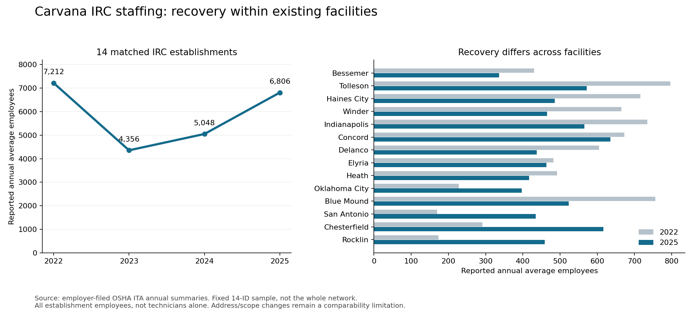

# IRC staffing test: official establishment panel

**Result:** the staffing leg is measured; the matched site-production leg is not. Across 14 original IRC establishment IDs appearing in each OSHA annual summary for 2022–2025, reported annual average employees rose 56.2% from the 2023 trough to 2025. This supports substantial expansion of the workforce at existing facilities. It does not establish causal production growth, utilization or profitable remaining demand.

## Matched observations

| IRC | 2022 | 2023 | 2024 | 2025 | 2025 versus 2022 |
|---|---:|---:|---:|---:|---:|
| Bessemer | 430 | 164 | 258 | 336 | −21.9% |
| Tolleson | 796 | 320 | 472 | 572 | −28.1% |
| Haines City | 716 | 296 | 350 | 486 | −32.1% |
| Winder | 665 | 371 | 407 | 465 | −30.1% |
| Indianapolis / Greenfield | 735 | 467 | 481 | 565 | −23.1% |
| Concord | 673 | 394 | 429 | 635 | −5.6% |
| Elyria | 482 | 322 | 325 | 463 | −3.9% |
| Delanco | 605 | 388 | 385 | 437 | −27.8% |
| Heath | 492 | 327 | 260 | 417 | −15.2% |
| Blue Mound | 756 | 400 | 398 | 523 | −30.8% |
| Oklahoma City | 228 | 228 | 325 | 397 | +74.1% |
| San Antonio | 170 | 131 | 245 | 435 | +155.9% |
| Chesterfield | 291 | 306 | 389 | 616 | +111.7% |
| Rocklin | 173 | 242 | 324 | 459 | +165.3% |
| **Total** | **7,212** | **4,356** | **5,048** | **6,806** | **−5.6%** |

Units: annual average employees as filed, including establishment functions beyond skilled technicians. These are neither December 31 headcounts nor full-time equivalents. The 2022 average includes months before and after layoffs; it is not the immediate post-cut workforce. The 2025 data were submitted through August 31, 2026 and describe calendar 2025, not 2026.

Sources: [OSHA ITA](https://www.osha.gov/itadata), [2022 ZIP](https://www.osha.gov/sites/default/files/ITA-data-cy2022.zip), [2023 ZIP](https://www.osha.gov/sites/default/files/ITA_300A_Summary_Data_2023_through_12-31-2024.zip), [2024 ZIP](https://www.osha.gov/sites/default/files/ITA_300A_Summary_Data_2024_through_12-31-2025.zip), [2025 CSV](https://www.osha.gov/sites/default/largefiles/ITA_300A_Summary_Data_2025_through_08-31-2026.csv). Downloaded through the in-app browser after the earlier Chrome attempt failed. The prior note's raw-data access gap is resolved.

## What this changes

1. **Existing-facility rebuilding is observable.** The matched sample added 2,450 average employees between 2023 and 2025. All 14 establishments had higher average employment in 2025 than 2023. The path was uneven: Heath declined again in 2024, while Chesterfield and Rocklin increased in every observed year.
2. **Different facilities are at different stages.** The ten panel sites also listed in the 2021 10-K had 6,350 employees in 2022, 3,449 in 2023 and 4,899 in 2025: +42.0% from 2023 but still −22.9% from 2022. The other four grew from 862 in 2022 to 1,907 in 2025. Thus recovery at established facilities and expansion at newer facilities coexist. [2021 IRC list](https://www.sec.gov/Archives/edgar/data/1690820/000169082022000080/cvna-20211231.htm).
3. **Historical staffing is not spare capacity.** A prior higher workforce shows that more people were employed at those locations. It does not prove they were productive, inexpensive, all still available locally, or capable of producing vehicles customers now want. Reinstating inefficient 2022 staffing is not automatically attractive.
4. **No numerical growth attribution is supported.** Company sales include a larger network and external/marketplace preparation. Dividing network sales by these 14 sites' employment would manufacture a productivity measure with mismatched populations.

## Hours: informative but not yet a clean production denominator

| Year | Same 14 sites: reported hours | Hours / average employee |
|---|---:|---:|
| 2022 | 13,020,405 | 1,805 |
| 2023 | 7,410,179 | 1,701 |
| 2024 | 7,244,948 | 1,435 |
| 2025 | 12,684,358 | 1,864 |

Reported hours rose 71.2% from 2023 to 2025, versus 56.2% for employment. But hours declined 2.2% in 2024 despite employment increasing 15.9%, followed by a 75.1% hours increase in 2025. Work schedules, part-time mix, timing and reporting scope could all contribute. This is not sufficient evidence of a specific overtime or productivity change. OSHA does not validate reported employees or hours. [User guide, pp.4–5](https://www.osha.gov/sites/default/files/ITA_data_users_guide.pdf).

## Address, population and reporting checks

- Constant establishment IDs do not guarantee constant operating scope. Tolleson and Indianapolis add addresses in later records; Chesterfield moves from an incomplete address to several addresses; Heath and Blue Mound change street numbers; Concord changes 3035 to 3025. Elyria changes its city label to Lorain while retaining the street location. The raw strings are preserved.
- Excluding all six material/incomplete street-address cases leaves eight IDs with employment of 3,469 / 2,142 / 2,619 / 3,478 in 2022–25. Their recovery from 2023 is 62.4%, while 2025 is approximately equal to 2022. Therefore the recovery conclusion survives the stricter match, but the exact remaining gap is sample-sensitive.
- Trenton, Tooele, University Park and West Memphis lack Carvana name/ID matches in the 2024 summary and are excluded from the complete panel, not assigned zero. Trenton, Tooele and University Park reappear in 2025 under new IDs at matching addresses. No missing year was imputed.
- ADESA records are excluded from the matched IRC total. In 2025 some properties have both ADESA and Carvana records; Indianapolis entries even repeat 424,020 hours with different employee counts. Adding all those records would risk double-counting and mixing auction/recon populations. The name-matched raw extracts are retained for later resolution, not aggregated.
- 2021 summaries were also retrieved, but IDs and coverage differ. They are retained in the source extract, not spliced into the constant-ID panel without address-level reconciliation.
- The secondary safety publisher's headline employee counts do not consistently match these official year-specific rows. They are not used.

## Attempt to match production

No verified annual completed-retail-vehicle series for a panel site was found in the expanded pass through existing notes/reports, site-tour coverage, municipal documents, local reporting, company announcements and role descriptions.

| Candidate | New or existing evidence | Why no output/staffing ratio |
|---|---|---|
| Haines City | Official staffing 296 → 350 → 486 in 2023–25. November 2025 tour coverage describes continued productivity improvements following earlier visits. | Public coverage gives no comparable output numerator; tour observation is qualitative and company-mediated. |
| Trenton | 2025 municipal minutes report about 222 FTEs on May 15, over 65 openings, and $49.9m investment versus $24m committed. OSHA has 310 annual average employees for 2025. | Different definitions/dates; no completed production figure. Do not equate FTEs with average employees. |
| Chesterfield | 2022 launch had one active line, 240 employees, and future targets for additional lines/output. | Announced 480/week is a target, not subsequent demonstrated production. |
| Heath | November 2022 anonymous testimony describes loss of second shift; later hiring evidence includes second-shift roles. Official staffing confirms contraction and recovery. | Testimony is unverified; postings do not establish staffed shifts or their output. |
| Winder | January 2025 reporting cites 130 inspections/day. | Inspection is not necessarily completed retail-ready output; no comparable pre/post series or matched labor window. |

[Haines City tour coverage, November 17, 2025](https://www.investing.com/news/analyst-ratings/da-davidson-reiterates-neutral-rating-on-carvana-stock-at-360-price-target-93CH-4362799); [Trenton May 15 minutes in June 5 packet, PDF pp.3–4](https://trentonoh.gov/AgendaCenter/ViewFile/ArchivedAgenda/_06052025-519); [Heath contemporaneous anonymous account](https://www.reddit.com/r/carvana/comments/yyfmg4); [Chesterfield opening](https://virginiabusiness.com/chesterfield-carvana-facility-opens-with-240-employees/); [Winder reporting](https://www.ajc.com/news/business/carvana-to-expand-repair-services-at-georgia-facility-adding-200-jobs/JVKTX2YK2BAXDEXZUFDSQBXMEA/).

The Trenton minutes also contain an obviously implausible company sales-goal transcription; that statement is excluded. The other municipal observations are attributed testimony rather than an audit of operations.

## Decision and precise remaining gap

### Baseline follow-up: Haines City and the proposed archive test

Address-level inspection confirms the 2021 Haines City record (different ID, same 3700 Bannon Island Road) has 487 annual average employees and 895,665 hours. The 2025 record has 486 employees and 896,613 hours. Thus staffing and hours are essentially back to 2021, while below the higher 2022 level of 716 employees and 1,295,143 hours. Neither year is pre-COVID. This is a one-site verified extension, not an automatic reconciliation of all 2021 IDs. [2021 official ZIP](https://www.osha.gov/sites/default/files/ITA-data-cy2021.zip).

Seven of the 14 matched IRCs have 2025 headcount below 80% of 2022: Bessemer, Tolleson, Haines City, Winder, Indianapolis/Greenfield, Delanco and Blue Mound. Ten of 14 are below 2022 at all. These are selected-sample staffing comparisons, not the share of all facilities underutilized. Haines City could hypothetically match 2022 output with 486 versus 716 employees if output per employee improved 47.3%; output and the improvement remain unmeasured.

Prioritized next tests, with distinct acceptance conditions:

1. Retrieve the two identified full sellside site-tour/IRC-economics reports through existing access. Seek actual dated output, active lines/shifts and matching scope. Do not substitute companywide rates for Haines City rates.
2. Pilot archived individual vehicle listings, including third-party syndication, for an explicit physical/processing location and first fully prepared listing date. A newly found indexed AutosToday Kona listing names Carvana Haines City, but the detail page did not open and the dealer/location meaning is unvalidated: https://www.autostoday.com/cars-for-sale/used-cars/listing/KM8HC3AB5SU206112/2025-hyundai-kona-sel-convenience-auto-haines-city-fl . This is a lead, not a working dataset. Validate repeated VINs across different market pages before collecting a series. Archive snapshots of a city search page alone cannot establish local production or completed sales. No Wayback coverage test has yet been completed.
3. Seek actual regulatory operating reports (paint usage, operating hours, observed production in inspection narratives), not merely permitted maxima. Initial indexed searches found no usable Carvana site series. Paint work measures a stage; changing paint incidence prevents direct conversion to total retail production without calibration.
4. Triangulate active versus installed lines, staffed shifts and skilled roles using dated facility records and tour accounts. Planned employment, occupancy limits and recruitment ads are not full-staffing denominators. A historical peak is only a benchmark until economical throughput is known.

Do not use parked-car satellite counts as production: they measure stock. Do not treat auction catalog turnover as retail output or listing disappearance as a confirmed sale. These routes can corroborate activity only after definitions and archive coverage are validated.

**Supported:** employment contracted and subsequently expanded materially at the same existing IRC establishments. This is consistent with reactivating operating capacity, rather than all growth requiring new property.

**Unresolved:** units produced per labor hour; historical/current utilization; contribution of staffing versus repair mix/process improvements; and the profitable production attainable by restoring previous staffing. No regression or elasticity is fitted because the dependent variable is missing.

The most specific next source lead is already referenced in supplied sellside file `work/sellside/07.txt`: Morgan Stanley, *Carvana's Flywheel: Haines City Tour + Investor Feedback*, November 18, 2025, and *Bridging Beyond 3 Million: Measuring the ROI on an IRC*, June 10, 2026. Their full contents were not present in the searched local text. These may contain actual throughput, labor hours or line configuration, but should be inspected before assuming they solve the gap. A repeated broad search or additional job-posting counts would not close it.

Reproduction: `build-staffing-panel.py` reads the five named official downloads, normalizes header case, retains name-matched establishment rows, asserts one observation per selected ID/year, sums the fixed panel, calculates sensitivity samples and produces the figure. `staffing-panel-data.json` preserves original field strings, source URLs and SHA-256 checksums. Unrelated repository work was not changed.
